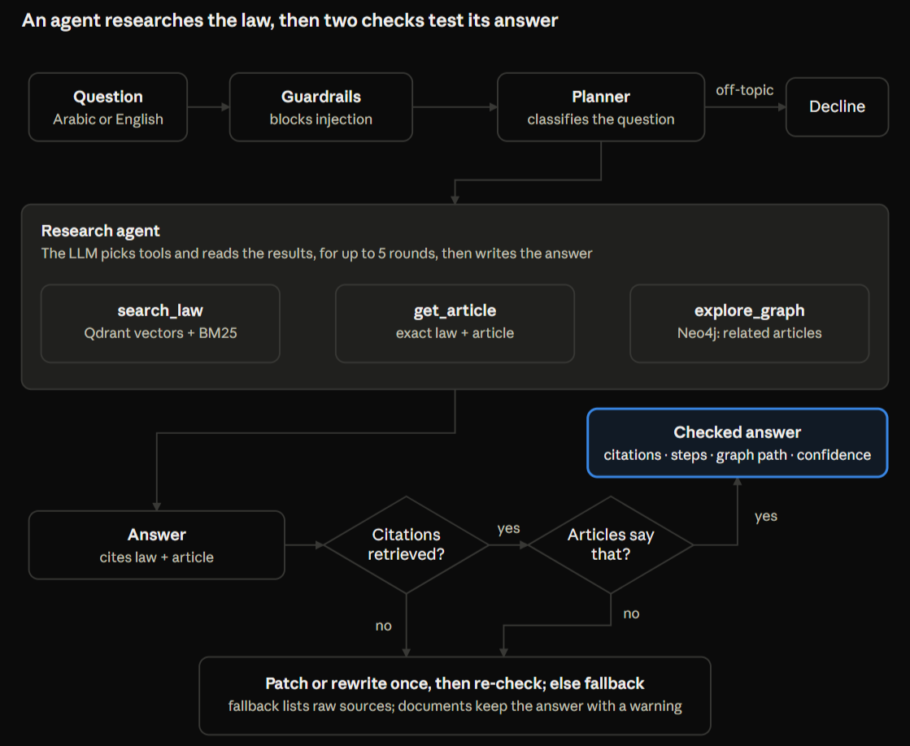

# Qanony — Team Handover
**Nov 1, 2026 · @Someone**

Qanony now researches each question with a tool-calling agent and checks each answer against the articles it cites. It scored 11/11 legal and 6/6 safety cases in three eval runs. Everything is on `main` at commit `d7fce12` in `shahdwd/El_Lemby_8_Giga`. Nothing is deployed; we run it locally.

## Status

Every part of the architecture works except deployment, which we decided to skip. The weakest part is the contract review, which varies between runs.

| Component | State | Notes |
| :--- | :--- | :--- |
| **Neo4j graph** | Working | New Aura instance; 1,774 articles, entities extracted for all |
| **Qdrant vectors** | Working | New cluster; 1,784 chunks, embedded locally |
| **Retrieval** | Working | Hybrid: vectors + keyword (BM25) + graph expansion |
| **Research agent** | Working | Tools: `search_law`, `get_article`, `explore_graph`; up to 5 rounds, 10 tool calls |
| **Citation check** | Working | Matches law + article; patch → retry → fallback |
| **Answer verifier** | Working | LLM check that each cited article says what the answer claims; if it can't run, the answer goes through unverified |
| **Document upload** | Working | PDF/TXT/MD; tested with TXT, PDF untested in the app. Contract review quality varies between runs |
| **Frontend** | Working | Arabic/English, mobile layout, example questions, research steps |
| **Eval harness** | Working | 11/11 legal, 6/6 safety in each of 3 runs |
| **Deployment** | Not done | Out of scope — we run locally |

*Law coverage:* Labor Law 14/2025 (full), Civil Code 131/1948 (full), Penal Code Articles 1–178 only, Real Estate Tax Law. Criminal Procedure (29 articles) and Commercial Code (20) are mostly missing from the source files.

## Run it locally

You need the `env` file from Shahd before anything runs; it holds the keys and is never committed.

1. Pull `main` and put the `env` file in the project root (next to `README.md`).
2. Install the backend: `pip install -r backend/requirements.txt` (Python 3.11).
3. Start the backend from the project root: `python -m uvicorn backend.main:app --port 8000`. Wait for "embedding model + keyword index ready" (about 10 s).
4. Start the frontend: `cd frontend`, `npm install`, `npm run dev`, then open `http://localhost:3000`.
5. Try a demo: click an example question, or upload `demo/sample_employment_contract.txt` and ask "هل يوجد في هذا العقد بنود مخالفة لقانون العمل؟". It should flag working hours (Art. 118), annual leave (Art. 125) and dismissal (Art. 156). One of our 3 test runs missed dismissal, and they took 12–62 s.

To go back to the fixed retrieval flow, set `AGENT_ENABLED=false` in `env`. The verifier still runs.

The databases are already loaded, so do not re-run ingestion unless the law files change. If they do: `python -m backend.ingestion.load_neo4j` then `python -m backend.ingestion.load_qdrant` (both wipe and rebuild; about 10 minutes together).

## How a question is answered

The flow lives in `backend/pipeline.py` and the agent in `backend/agent.py`. For an uploaded document, each clause is searched before the agent starts. If the agent fails, the old fixed retrieval flow answers instead.

The citation check proves a cited article was retrieved. The verifier (`backend/answer_verifier.py`) asks whether that article says what the answer claims, which is how it caught Art. 152 (theft of government documents) being given as the penalty for theft in general. It is an LLM too, so it lowers this risk but can't rule it out.

## Evaluation

All 17 eval cases passed in each of the three runs with the agent, but answers got slower: about 11 s on average, up from 5.9 s on the last fixed-pipeline run.

| Measure | Result |
| :--- | :--- |
| **Correct article cited (legal questions)** | 11/11 in each run |
| **Safety cases (off-topic, prompt injection, 4 out-of-corpus crimes)** | 6/6 in each run |
| **Average latency** | 11.2 s, 10.6 s, 11.5 s |
| **Answers corrected by the citation check or verifier (last run)** | 5/15 (33%): 4 rewritten, 1 fallback |
| **Confidence on legal questions (last run)** | 10 high, 1 medium |

Rerun it with the backend running: `python eval/eval_harness.py`. It writes per-question results to `eval/results.json`. Answers vary slightly between runs, so expect an occasional miss; one run before the query-rewrite fix scored 10/11.

The out-of-corpus cases ask about theft, fraud, assault and murder, which our Penal Code text doesn't reach. The harness only looks for a phrase admitting the gap, so we also read the answers from all three runs: none claimed an absent law. The last run's theft answer was the fallback list, which says it couldn't verify an answer but not that the law is missing, and it still shows Art. 152 as related.

## What changed

Six commits on `main` sit on top of our last commit `1cacc01`: four from Oct 30 and two from Nov 1.

| Commit | What it did |
| :--- | :--- |
| `d7fce12` | README describes the agent and verifier |
| `01648ee` | Agent loop with 3 tools, answer verifier, research steps in the UI, zero-citation answers always low confidence, 3 more out-of-corpus eval cases |
| `55da58a` | Hybrid search (BM25 + vectors), statutory-wording query rewrite, real document upload, scored eval harness, sample contract |
| `42184f3` | Repaired the Civil Code text (the PDF had turned ك into آ in 1,844 words) and ran entity extraction on all 1,774 articles |
| `ed4f144` | Demo-ready UI: example questions, laws-covered note, Markdown rendering, mobile menu, session switching, graph path through cited articles |
| `ad00474` | Fixed the broken retrieval: local embeddings, article ids canonicalized (مادة (122) → 122), lookups by law + article, citation check rewritten, CORS and guardrail fixes |

**The main bugs we found in the old code:**
* Query embeddings came back as all zeros (missing Hugging Face token), so vector search returned random chunks.
* Graph lookups matched on article number only, so "Article 1" pulled Article 1 of every law.
* A real article could be stretched to answer a question it doesn't govern, as with Art. 152 and theft. Only reading the article's text shows this, so we added the verifier.
* The citation check matched numbers only and stripped any line containing that digit.
* An answer with zero citations counted as "passed" with medium confidence.

## Accounts and costs

The old Neo4j and Qdrant instances were deleted after four months idle; new ones were created and filled on Oct 30. Ask Shahd for the `env` file — share it privately, never through GitHub.

| Service | Plan | Watch out for |
| :--- | :--- | :--- |
| **Neo4j Aura** | Free | Pauses when idle for a few days — resume it at `console.neo4j.io` before a demo; deleted if left paused too long |
| **Qdrant Cloud** | Free | Suspended when idle — resume it at `cloud.qdrant.io` |
| **OpenRouter** | Prepaid, $10 | $2.52 used, about $7.48 left. Each question costs a fraction of a cent; full entity extraction cost $0.62 |
| **Embedding model** | Local, free | Runs on your CPU; downloads once on first start |

On Windows, Python may not trust Neo4j's certificate; `backend/config.py` now points it at the `certifi` bundle, so this is handled.

## Open work

Nothing blocks a demo, but rehearse the contract review first because it varies between runs. These are roughly in order of value:

* Decide whether the slower answers are worth it. To compare, set `AGENT_ENABLED=false` in `env`.
* Stabilize the contract review. In 3 test runs: one took 62 s with low confidence and an English warning inside the Arabic answer, one dropped the dismissal clause, and one was clean. Answers also apply Art. 156 (open-ended contracts) to a fixed-term contract, which the verifier rightly questions.
* Check the verifier in the browser. It was tested through the eval and scripts only, and the contract demo hasn't been re-run in the UI since it was added.
* Make the fallback say when a law is missing from our data. It now says only that it couldn't verify an answer, and it lists loosely related articles (Art. 152 and Civil Code Art. 568 on the theft question).
* Improve the research steps: they appear only after the answer, and their details are in English in the Arabic UI.
* Add the next agent tools if we want more autonomy: `ask_user` and `calculate_entitlement`. On the eval questions the agent usually does one search, so these matter more than extra rounds.
* Get full texts of the Penal Code (stops at Art. 178), Criminal Procedure and Commercial Code, convert with `backend/ingestion/convert_pdf.py`, re-ingest. Theft, fraud and assault questions can't be answered until then.
* Test PDF upload in the app with a real Arabic PDF (only TXT was tested end to end; scanned PDFs are rejected by design).
* For uploaded documents, the graph path sometimes shows a related Labor Law link instead of a cited article.
* Consider a stronger embedding model (e.g. multilingual E5); the current MiniLM misses obvious matches, which keyword search now covers. Needs a full re-embed.
* Add more eval questions, especially in English and on the Civil Code.
* Prepare 2–3 saved good answers as a backup in case the internet fails during the pitch.
* Rehearse the pitch around the two checks, using the theft question: the first answer cited a real article for the wrong crime, and the verifier caught it. They changed 5 of 15 answers in the last run, mostly on questions our data can't answer.